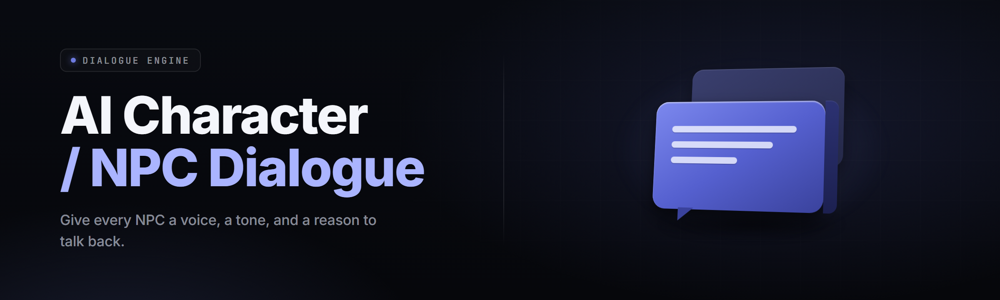

  
  
  

  

  
  
  

---

**Offline neural dialogue compiler that spawns infinite, in-character NPC conversation trees for game devs, writers, and modders.**

  

---

## Table of Contents

- [System Requirements](#system-requirements)
- [The Problem](#the-problem)
- [Quick Start](#quick-start)
- [FAQ](#faq)
- [All Modules Status](#all-modules-status)
- [Usage Guidelines](#usage-guidelines)
- [Grouped Module Catalog](#grouped-module-catalog)
- [What is NPC Dialogue Generator](#what-is-npc-dialogue-generator)
- [Tips for Best Results](#tips-for-best-results)
- [Installation](#installation)
- [Compatibility](#compatibility)

---

## 🖥️ System Requirements

Runs as a standalone `.exe`. No runtime installs, no Python, no Node.

| Component | Minimum | Recommended |
|-----------|---------|-------------|
| OS | Windows 10 64-bit (1809+) | Windows 11 23H2+ |
| CPU | 4-core x64 @ 2.4 GHz | 8-core @ 3.6 GHz |
| RAM | 8 GB | 16 GB |
| GPU | DirectX 11, 2 GB VRAM | DirectX 12, 6 GB VRAM |
| Disk | 1.4 GB free | 4 GB SSD free |
| Runtime | .NET Desktop Runtime 6 | .NET Desktop Runtime 8 |
| Model Cache | 900 MB classifier+tagger | 2.3 GB full persona pack |

---

## 🩹 The Problem

Dialogue in indie and mod projects dies the same three deaths over and over.

- **Hand-authored trees don't scale.** One writer, 400 lines per NPC, five NPCs, and the project grinds to a halt.
- **Generic LLM output drifts out of character** after three exchanges unless you paste a two-paragraph system prompt every single turn.
- **No game-engine integration.** Copy from a browser tab, strip markdown, reformat to your dialogue schema, paste. Six times a scene.
- **Voicing relationships is manual.** NPC A remembers NPC B, faction state changes, prior quest outcomes — all wired by hand or not at all.
- **Localization explodes the line count.** Every branch triples when you fork by language, tone, or register.
- **Cost-per-token rack abuse.** Cloud APIs charge per NPC-per-day in any live game with ambient chat.
- **Review/approval flow is spreadsheet-shaped.** Writers email `.docx`, designers merge manually, and revisions are lost.

---

## ⚡ Quick Start

🔪 Step 1 — Visit the project page and grab the release archive.

🖱️ Step 2 — Extract the `.exe` to any folder. No installer, no admin prompt.

▶️ Step 3 — Launch the `.exe`. First run extracts the model pack to `%LOCALAPPDATA%\NpcDialogueGen`.

🧠 Step 4 — Load a character card (or drop in a `.json` persona) on the **Cast** tab.

📤 Step 5 — Hit **Generate Tree**, choose branch depth, export as JSON / Ink / Yarn / CSV.

---

## ❓ FAQ

<b>Does the .exe need an internet connection?</b>

No. All inference runs locally against the packed models. Internet is only needed for update checks, which you can disable in Settings → Updates.

<b>Why does Windows SmartScreen warn about the .exe?</b>

Unsigned community binary. Click **More info → Run anyway**, or verify the SHA-256 in the release notes before launching.

<b>Can I ship generated dialogue in a commercial game?</b>

Yes. Anything you generate with your own persona and your own card content is yours. The bundled sample sets are CC-BY and attribution is a single comment.

<b>How many characters can run simultaneously?</b>

Up to 32 concurrent persona states in-memory. Beyond that the serializer spills to disk and latency climbs from ~40 ms to ~140 ms per line on a mid-tier CPU.

<b>Will it output in my game's dialogue schema?</b>

Ship-ready exporters for Ink, Yarn Spinner, Twine Twee, Godot `.tres` dialogue, Unity Addressables text assets, custom JSON, CSV, and a generic `.tsv` for spreadsheet writers.

<b>Is there a way to keep NPCs from leaking modern slang?</b>

Yes. The **Register Lock** filter tags time-period and tone. Set a Regency, fantasy-medieval, cyberpunk, or custom register and out-of-era tokens get flagged in the review pane.

<b>Why do some branches repeat?</b>

**Branch Novelty** defaults to Balanced. Push it to Aggressive and the tree will throw away near-duplicates, at the cost of ~20% more generation time per node.

<b>Can I import a whole cast from an existing screenplay?</b>

Yes. The **Cast Importer** reads `.fountain`, `.txt`, Fade In `.fdx`, and Final Draft `.fdx`-adjacent formats, extracts speaker lines, and builds character cards with inferred traits.

<b>Does voice acting integration exist?</b>

A **Line Bundler** module exports one `.wav`-slot manifest per NPC so you can hand it to a VO pipeline. Audio synthesis itself is out of scope.

---

## 🧩 All Modules Status

| Module | Status | Description |
|--------|--------|-------------|
| Persona Card Loader | ✅ Working | Loads `.json` / `.yaml` cards with traits, backstory, register. |
| Branch Tree Compiler | ✅ Working | Generates a full dialogue tree from a seed line + depth. |
| Register Lock | ✅ Working | Locks era, tone, formality register across a whole cast. |
| Relationship Memory | ✅ Working | Per-pair NPC state persists across branch rolls and sessions. |
| Faction State | ✅ Working | Treats known factions as first-class context variables. |
| Branch Novelty Filter | ✅ Working | Rejects near-duplicate nodes using a fuzzy hash. |
| Cast Importer | ✅ Working | Parses screenplays, .txt scripts, and card bundles. |
| World Bible Sync | ✅ Working | Reads a `lore.md` / `world.json` and injects world facts. |
| Export · Ink | ✅ Working | Emits runnable Ink `.ink` with knots per branch. |
| Export · Yarn | ✅ Working | Emits Yarn Spinner nodes ready to compile. |
| Export · Godot | ✅ Working | Emits `.tres` dialogue resources. |
| Export · JSON/CSV/TSV | ✅ Working | Generic flat and structured exports for any pipeline. |
| Quest-State Gate | ✅ Working | Branches conditionally on quest flags you define. |
| Tone Console | ✅ Working | Real-time tone knob: warm, cold, sullen, sardonic, etc. |
| Localization Retarget | ✅ Working | Re-rolls locales while preserving branch shape. |
| Dialogue Review Pane | ✅ Working | Approve / reject / annotate inline with a tag system. |
| Diff Viewer | ✅ Working | Visual tree diff between passes and writer edits. |
| Snapshot Driver | ✅ Working | Whole-cast snapshots for version-controlled review. |
| Custom Rule Injection | ✅ Working | Hard/soft rules ("never swear", "always use honorifics"). |
| Benchmark Suite | ✅ Working | Measures ms/line and branches/sec on this machine. |
| Line Bundler | ✅ Working | WAV-slot manifests for VO handoff. |
| Script Hot-Swap | ✅ Working | Live reload of persona cards while the tree refreshes. |
| Audit Log | ✅ Working | Every annotation and rule change tracked per session. |
| Crash Guard | 🟡 Beta | Auto-save rebuilder after an unclean exit. |
| Cloudless Refresh | 🟡 Beta | Offline self-updater for the packed models when a user opts in. |
| Beat Scheduler | ✅ Working | Places tension beats (pause, reveal, taunt) at set intervals. |
| Voice-Persona Mapper | ✅ Working | Rolls a distinctive cadence fingerprint per NPC at import. |
| Cost Governor | ✅ Working | When using optional remote helpers, caps requests/line/turn. |

---

## ⚖️ Usage Guidelines

| Allowed | Not allowed |
|---------|-------------|
| Generating original dialogue for your own or client work | Distributing a bundled dataset you were not licensed to include |
| Retargeting locales using the Localization Retarget tool | Shipping retarget output without a translator pass on scene-critical lines |
| Modding existing games that permit text injection | Modding games whose EULA forbids script injection in online modes |
| Reusing your own persona cards across projects | Reuploading the packaged model weights as your own |
| Editing exporter templates to match your engine | Removing attribution from the CC-BY sample sets |

---

## 🗂️ Grouped Module Catalog

Eighteen primary modules, eight support engines, one audit path. Grouped by the job to be done.

### 🎭 Character Creation

The Cast module is where every project starts. Persona cards are plain text or JSON — trait vectors, backstory, voice cadence, historical register. Drop a screenplay and the Cast Importer populates the shelf automatically, inferring each speaker's cadence from their lines.

- **Persona Card Loader** — pulls traits, backstory, and register from `.json` / `.yaml`
- **Cast Importer** — screenplay and script parser that rebuilds the speaker inventory
- **Voice-Persona Mapper** — cadence fingerprint per NPC (rhythm, sentence length, favorite connectives)
- **Register Lock** — era/time-period tag prevents anachronistic leaks

### 🌳 Branch Generation

Branch generation is the core loop: seed line goes in, dialogue tree comes out, branch depth controls how deep each conversational avenue forks. The novelty filter prunes duplicate beats before they hit review, so you review four good branches instead of sixteen stale ones.

- **Branch Tree Compiler** — seed line + depth → full tree
- **Branch Novelty Filter** — fuzzy-hash near-dupe removal
- **Beat Scheduler** — places reveals and tension beats on a chosen cadence
- **Tone Console** — live tone knobs, no re-roll needed for a small shift

### 🧠 Memory & World State

Scope is where NPC dialogue usually dies. This project carries three state layers concurrently — per-pair memory, faction state, and quest flags — so an NPC's response to your hero changes after their best friend was killed three scenes earlier.

- **Relationship Memory** — per-pair NPC state persists across the whole tree
- **Faction State** — known faction variables are first-class inputs
- **World Bible Sync** — `world.json` and `lore.md` injected as context
- **Quest-State Gate** — conditional branches gated on your quest flags

### ⚙️ Export Pipeline

The Export suite speaks native to the engines the community actually ships in. Every exporter uses the same intermediate tree; only the emitters differ. Adding your own is a single-plugin diff.

- **Export · Ink** — knot-per-branch, ready to `inklecate`
- **Export · Yarn** — node-per-scene, ready for Yarn Spinner
- **Export · Godot** — `.tres` dialogue resources
- **Export · JSON / CSV / TSV** — for pipelines that aren't picky

### 🧪 Review & Tooling

The Review Pane is a two-column view: tree on the left, annotations on the right. Writers approve or reject per-node; every tone shift and every rule violation gets a tag. The Diff Viewer shows branch-level changes between two snapshots so you don't read the whole tree looking for a line that moved.

- **Dialogue Review Pane** — approve/reject per node
- **Diff Viewer** — branch-level visual diff between passes
- **Snapshot Driver** — full-cast snapshots for version-controlled review
- **Audit Log** — every annotation and rule change tracked

### 🧷 Compliance & Locales

When you ship a cast of thirty across four languages, compliance and localization stop being afterthoughts. Register Lock tags era violations before a writer even opens the review pane. Localization Retarget keeps the branch shape intact and only rolls the surface language.

- **Register Lock** — swaps register and flags violations across an entire pass
- **Localization Retarget** — refits surface language without reshuffling the tree
- **Custom Rule Injection** — hard and soft rules ("never swear", "always use honorifics")
- **Line Bundler** — VO-slot manifests per NPC

---

## 📖 What is NPC Dialogue Generator

A single-binary desktop tool that compiles character cards plus a branch schema into dialogue trees your engine can eat.

| Term | Explanation |
|------|-------------|
| **Persona Card** | A JSON/YAML file describing one NPC — traits, cadence, register, backstory, taboos. |
| **Branch** | One conversational avenue from a node, target of a compiled tree edge. |
| **Register** | Era/time-period/time-of-day idiom constraint per NPC or entire cast. |
| **Rule Injection** | Hard/soft constraints on generated lines ("never swear", "use honorifics"). |
| **Novelty Score** | A hash-based metric used to reject near-duplicate branches. |
| **Snapshot** | Timestamped capture of the whole cast + rules, used to diff and roll back. |
| **Beat** | A planned tension marker (reveal, pause, taunt) inserted on a cadence. |

Five things it buys you:

- **Your tone, not a chatbot's.** Register Lock and Tone Console mean every line stays inside the fiction.
- **Zero cloud dependency.** Full offline inference — no per-token meter.
- **Engine-native export.** Ink, Yarn, Godot, JSON — no reformatting pass.
- **Memory that survives the scene.** Relationship, faction, and quest state persist across branches.
- **A review path.** Nothing ships without passing the pane and the audit log.

---

## 💡 Tips for Best Results

- Write persona cards last. Start with a **Cast Importer** run on existing scripts; the inferred traits are a better starting point than a blank card.
- Set **Register Lock first**, before your first generation pass. Fixing anachronisms branch-by-branch never holds.
- Turn **Branch Novelty** to Aggressive on side-quest chatter, Balanced on main-story beats.
- Pin **Relationship Memory** seeds for any pair you plan to test across a cast refresh — pinning + snapshot together give you real diffs.
- Run **Benchmark Suite** once per machine. Numbers off by 3x usually means the wrong GPU got selected.
- Batch your exports — the same intermediate tree drives every exporter, so Ink-then-Yarn-then-JSON is one action, not three.
- Snapshot before every large rule edit. The Diff Viewer is only useful if you have a clean prior state.
- Annotate in the Review Pane as you read. Tags come back as a per-NPC style summary when you're done.

---

## 🧰 Installation

**1. Download the release archive.** Grab the `.exe` bundle for Windows from the project page. 

  

**2. Extract to a normal folder.** Any path without characters Windows hates. No installer, no PATH edits, no admin prompt. `C:\Apps\npc-dialogue-generator\` works fine.

**3. Run the `.exe`.** First launch unpacks the model pack into `%LOCALAPPDATA%\NpcDialogueGen\models\` and warms the runtime. Launch again after the first run and cold-start drops to a few seconds.

**4. Optional — move the model cache.** If your system drive is tight, point `Settings → Storage → Model Cache` at any other drive after first launch.

---

## 🖱️ Compatibility

| Platform | Status | Notes |
|----------|--------|-------|
| Windows 11 x64 | ✅ Fully supported | Recommended. DirectX 12 paths enabled. |
| Windows 10 x64 (1809+) | ✅ Supported | DirectX 11 render path automatic. |
| Linux (Proton) | 🟡 Community | Works under Proton 8; launch flags in the Community wiki page. |
| macOS | ❌ Not shipped | No signed build. Community forks only. |
| WSL2 | 🟡 Rare | Use for host files; run the `.exe` natively on Windows side. |
| Steam Deck (Linux) | 🟡 Community | Proton layer, controller mapping contributed by community. |

---

  

The Cast is the unit of work — build them cleanly, lock their register, and the whole tree falls out of it. Persona cards are the highest-leverage file in your project; treat them like code and version-control them next to the tree exporter. Fork it, rename your casts, ship.
